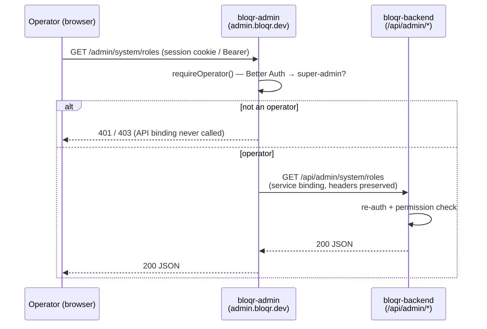

# bloqr-admin Worker

`bloqr-admin` is the dedicated Cloudflare Worker that serves the **operator /
system-admin** console at <strong>`admin.bloqr.dev`</strong>. It is deployed and versioned
independently from the main `bloqr-backend` Worker (its own script name, its
own `wrangler.toml`) and lives at `worker/admin-app/` in the monorepo — the
same pattern the sibling `bloqr-mail` Worker uses.

## Why a separate host and worker?

Bloqr has **two distinct admin surfaces**, intentionally separated by hostname
so the blast radius of the more powerful one is fenced off.

| Surface | Host | Audience | Served by |
| --- | --- | --- | --- |
| **User (tenant) admin** | `app.bloqr.dev/admin` | An account's own admins | Angular SPA + `bloqr-backend` `/api/admin/*` |
| **Operator / system admin** | `admin.bloqr.dev` | Bloqr operators (`super-admin`) | <strong>`bloqr-admin`</strong> (this worker) |

The user admin panel manages a single account. The operator console reaches
across the whole platform (cross-tenant user management, role assignment,
tier/scope/endpoint registries, feature flags, storage tools, Cloudflare
audit). Putting the operator surface on its own host and worker means a bug or
misconfiguration in one surface cannot expose the other, and the operator host
can carry a tighter CORS + security-header policy.

## Thin gateway, single source of truth

`bloqr-admin` is a **thin operator gateway**, not a second copy of the admin
API. All admin business logic — handlers, Zod schemas, D1 access — stays in the
`bloqr-backend` worker. The gateway's job is narrow and security-critical:

1. <strong>Terminate the host boundary.</strong> Strict CORS locked to the operator origin,
   `X-Frame-Options: DENY`, `Referrer-Policy: no-referrer`, HSTS preload.
2. <strong>Enforce the operator gate.</strong> `requireOperator()` verifies a Better Auth
   session and requires the resolved role to be `super-admin` — *before*
   anything is forwarded. Holding an individual permission is **not** enough;
   this is a role gate, not a permission gate. It is the exact same guard the
   main worker exposes (`worker/middleware/admin-role-middleware.ts`), imported
   directly, so there is one operator-gate implementation.
3. <strong>Forward over a service binding.</strong> The now-authorized request is proxied to
   `bloqr-backend`'s existing `/api/admin/*` routes via the `API`
   Cloudflare service binding — a Worker-to-Worker call with no public network
   hop. The downstream handlers re-authenticate and apply their own
   finer-grained permission checks, so the edge gate is **defense in depth**,
   not the only line.



## Routes served on `admin.bloqr.dev`

| Path | Behaviour |
| --- | --- |
| `GET /` | Minimal dark-first operator console landing shell (`noindex`) |
| `GET /health` | Liveness probe — `{ status: "ok", worker, time }` |
| `GET /meta` | Service descriptor: environment + which bindings are wired |
| `ALL /api/admin/*` | Operator-gated, forwarded to `bloqr-backend` |
| `ALL /admin/*` | Alias of the above (rewritten to `/api/admin/*`) |
| anything else | `404` — this host is **not** a general API mirror |

`/health` and `/meta` responses are validated with Zod
(`AdminHealthSchema`, `AdminMetaSchema`) before they leave the worker, so the
contract can never silently drift.

## Bindings

Configured in `worker/admin-app/wrangler.toml`:

| Binding | Kind | Purpose |
| --- | --- | --- |
| `API` | Service | Forward target — the `bloqr-backend` Worker |
| `ADMIN_DB` | D1 | Edge role resolution (`admin_role_assignments` / `admin_roles`). Migrations are **owned by the main worker** (`admin-migrations/`) — never migrate from here |
| `RATE_LIMIT` | KV | Resolved-role cache, shared with the main worker so a role lookup is cached once and reused across both |

The operator gate verifies a Better Auth session at the edge, so the same auth
secrets the main worker uses must be set on this worker:

```sh
cd worker/admin-app
wrangler secret put BETTER_AUTH_SECRET
wrangler secret put BETTER_AUTH_API_KEY
wrangler secret put BETTER_AUTH_KV_URL
```

Never commit secrets. For local development, put them in a gitignored
`.dev.vars` inside `worker/admin-app/`.

## Routing (Cloudflare)

The worker claims the operator host via its `wrangler.toml` routes:

```toml
[[routes]]
pattern = "admin.bloqr.dev"
custom_domain = true

[[routes]]
pattern = "*.admin.bloqr.dev/*"
zone_name = "bloqr.dev"
```

This matches the DNS record `admin.bloqr.dev` and the wildcard route
`*.admin.bloqr.dev/*`.

## Develop, test & deploy

```sh
deno task wrangler:admin:dev       # local dev server for bloqr-admin
deno task wrangler:admin:deploy    # deploy to admin.bloqr.dev
deno task check:worker             # typecheck (includes admin-worker.ts)
deno test --allow-read --allow-write --allow-net --allow-env worker/admin-app/
```

## Security model

- <strong>Fail closed everywhere.</strong> Missing `ADMIN_DB` ⇒ `503`; missing/invalid
  session ⇒ `401`; authenticated non-operator ⇒ `403`; missing `API`
  binding ⇒ `503`. There is no code path where an unauthorized request reaches
  the backend.
- <strong>No secrets in `wrangler.toml`.</strong> Only non-secret vars (`ENVIRONMENT`,
  `ADMIN_ALLOWED_ORIGINS`) live there; auth secrets are Worker Secrets.
- <strong>Preserved credentials.</strong> The gateway forwards the original `Authorization`
  header / session cookie unchanged so the downstream handler re-verifies the
  caller — the gateway never mints or elevates credentials. It adds audit
  headers (`X-Bloqr-Admin-Gateway`, `X-Bloqr-Operator-Id`,
  `X-Forwarded-Host`) for traceability only.
- <strong>Tight CORS.</strong> Only `https://admin.bloqr.dev` (plus any explicitly
  configured `ADMIN_ALLOWED_ORIGINS`) is reflected; localhost origins are
  trusted only outside production.

## Design

The operator landing shell is **dark-first** and expresses its palette as
[Filter](https://github.com/Bloqr-Systems/bloqr-design-system) design-system
CSS custom properties (`--bg-base`, `--accent`, `--link`, …), with the
canonical dark-first values as fallbacks only. The accent is Filter orange
(`#FF5500`), never white or a light background. See the design system's
`guidelines/OPERATOR_CONSOLE.md` for the operator-console design contract that
both this shell and the Angular operator panels follow.
