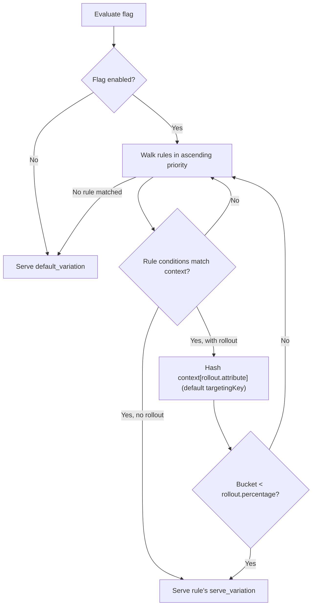

# Feature Flags

Feature flags are 100% Cloudflare-native via [Cloudflare Flagship](https://developers.cloudflare.com/flagship/) — there is no bespoke flag storage or evaluation logic anywhere in this codebase. Flags, targeting rules, and percentage rollouts are configured from **Compute > Flagship** in the Cloudflare dashboard and propagate globally within seconds — no redeploy required.

This fully replaces two earlier homegrown systems, both removed:

- A D1-backed `feature_flags` table with hand-rolled rollout-percentage/tier/user targeting logic (`worker/services/admin-feature-flag-service.ts` used to query it directly; now it proxies the Flagship management API instead).
- A simple KV-backed on/off flag store (`worker/services/feature-flag-service.ts`, deleted). It was never used in production, so no migration of existing flag state was needed.

Flagship's dashboard covers the same use cases (kill-switches, gradual rollouts, tier-gated betas, user overrides) with a real UI, audit history, and 11 comparison operators for targeting instead of bespoke SQL or KV JSON blobs.

## Two separate concerns

| Concern | Mechanism | Needs an API token? |
| --- | --- | --- |
| **Evaluation** — "is this flag on for this request?" | The `[[flagship]]` Worker binding (`env.FLAGS`), wrapped by `worker/services/flagship-feature-flag-service.ts` via the OpenFeature SDK | No — the binding authenticates automatically |
| **Management** — create/update/delete/list flags | The admin API proxy (`/admin/config/feature-flags`), backed by `worker/services/admin-feature-flag-service.ts` and `src/services/cloudflareApiService.ts` | Yes — `FLAGSHIP_API_TOKEN` with "Flagship Edit" permission |

Never call the management API on a hot request path — it's an HTTP round-trip to `api.cloudflare.com`. Evaluation always goes through the binding.

## Evaluating a flag in the Worker

```ts
import { createFlagshipFeatureFlagService } from '../services/flagship-feature-flag-service.ts';
import { silentLogger } from '../../src/utils/index.ts';

const flags = createFlagshipFeatureFlagService(env.FLAGS, silentLogger);
if (await flags?.isEnabled('new-checkout', false, { targetingKey: userId, plan: userTier })) {
    // ...
}
```

- `targetingKey` is the OpenFeature-reserved attribute percentage rollouts bucket on by default — pass it for stable per-user bucketing.
- `isEnabled()` never throws; evaluation failures (binding errors, an app that hasn't propagated yet) resolve to the `fallback` you provide.
- `getAllEnabled()` iterates the compile-time-known `FEATURE_FLAG_KEYS` array (see `src/platform/FeatureFlagService.ts`) since Flagship's binding has no "list all flags" call — add new flag keys there to include them.

## Managing flags via the admin API

```
GET    /admin/config/feature-flags        — list flags in the configured app
POST   /admin/config/feature-flags        — create a flag
PATCH  /admin/config/feature-flags/{key}  — partially update a flag
DELETE /admin/config/feature-flags/{key}  — permanently delete a flag
```

All routes require Admin tier + `admin` role (create/update/delete additionally require the `flags:write` permission on the legacy RBAC path) and return `503` if `CF_ACCOUNT_ID`, `FLAGSHIP_APP_ID`, or `FLAGSHIP_API_TOKEN` aren't configured.

### Create a boolean flag

```bash
curl -X POST https://api.bloqr.dev/admin/config/feature-flags \
  -H "Authorization: Bearer $JWT" \
  -H "Content-Type: application/json" \
  -d '{
    "key": "streaming-api-beta",
    "enabled": true,
    "default_variation": "off",
    "variations": { "off": false, "on": true },
    "rules": [],
    "description": "Server-sent events streaming API"
  }'
```

### Toggle a flag (PATCH only sends what changes)

`PATCH` merges your payload over the flag's current definition before writing — Flagship's own update endpoint replaces the entire flag, so `admin-feature-flag-service.ts` reads-then-writes so a simple toggle never wipes out existing rules or variations.

```bash
curl -X PATCH https://api.bloqr.dev/admin/config/feature-flags/streaming-api-beta \
  -H "Authorization: Bearer $JWT" \
  -H "Content-Type: application/json" \
  -d '{ "enabled": false }'
```

### Delete a flag

```bash
curl -X DELETE https://api.bloqr.dev/admin/config/feature-flags/streaming-api-beta \
  -H "Authorization: Bearer $JWT"
```

## Targeting rules and percentage rollouts

Configured entirely in the Cloudflare dashboard (or via the same admin API, with a `rules` array) — not reimplemented locally. A rule has ordered `conditions` (attribute comparisons, optionally grouped with `AND`/`OR`, nested up to 5 levels), a `serve_variation`, and an optional `rollout` (percentage + sticky-bucketing attribute):



The 11 supported operators: `equals`, `not_equals`, `greater_than`, `less_than`, `greater_than_or_equals`, `less_than_or_equals`, `contains`, `starts_with`, `ends_with`, `in`, `not_in`. See `FlagshipConditionSchema` / `FlagshipRuleSchema` in `worker/schemas.ts` for the exact request/response shape (Zod-validated at the trust boundary).

## Configuration

```toml
# wrangler.toml
[[flagship]]
binding = "FLAGS"
app_id = "<APP_ID>"   # Compute > Flagship in the dashboard

[vars]
FLAGSHIP_APP_ID = "<APP_ID>"   # same app_id, exposed to the admin API proxy
```

```sh
wrangler secret put FLAGSHIP_API_TOKEN   # account API token with "Flagship Edit" permission
```

See the `[[flagship]]` block in `wrangler.toml` and the `FLAGSHIP_APP_ID`/`FLAGSHIP_API_TOKEN` comments in `.dev.vars.example` for the full setup checklist, including how to create the app.

When `env.FLAGS` is absent (no Flagship app configured yet, e.g. a fresh local
checkout before running the setup steps above), `createFlagshipFeatureFlagService()`
returns `undefined` and callers should treat every flag as disabled — there is
no separate fallback provider to fall back to.

## What was removed

- `worker/services/feature-flag-service.ts` — `KvFeatureFlagService`, `NullFeatureFlagService`, `createFeatureFlagService()`, and the `FEATURE_FLAGS` KV namespace binding. Deleted outright (not deprecated) since it was never used in production.
- The D1 `feature_flags` table — dropped via migration (see `docs/admin/database-schema.mdx`). `worker/services/admin-feature-flag-service.ts` no longer touches D1 at all for flags.
