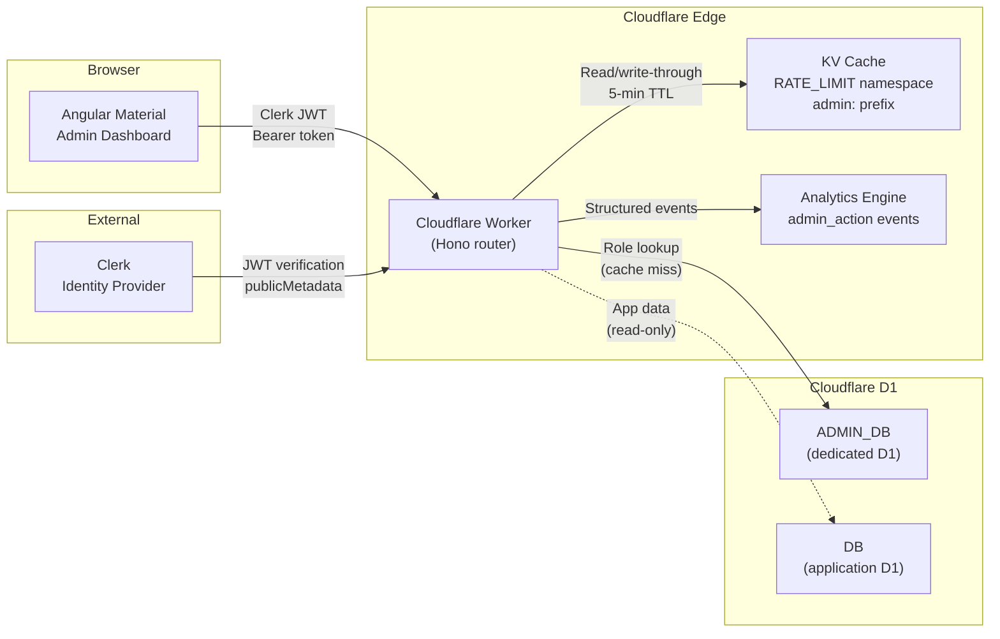

# Admin System

The bloqr-backend admin system is a 10-panel Angular Material dashboard backed by a Cloudflare Worker API. It provides granular, role-based control over every runtime aspect of the platform — tiers, scopes, feature flags, endpoint overrides, announcements, and user management — without redeploying.

## Architecture

## Two admin surfaces, two hosts

Bloqr separates administration into two surfaces on two hosts so the more
powerful one is fenced off:

| Surface | Host | Audience |
| --- | --- | --- |
| **User (tenant) admin** | `app.bloqr.dev/admin` | An account's own admins |
| **Operator / system admin** | `admin.bloqr.dev` | Bloqr operators (`super-admin`) |

The operator surface is served by the dedicated <strong>`bloqr-admin` Worker</strong> — a
thin gateway that operator-gates requests at the edge and forwards them to this
same admin API over a service binding. See
[bloqr-admin Worker](/admin/bloqr-admin-worker).

## Key Design Decisions

### Dedicated ADMIN\_DB for blast-radius isolation

The admin system uses its own D1 database (`ADMIN_DB`) rather than sharing the application's `DB` binding. This ensures:

- **Schema isolation** — Admin migrations live in `admin-migrations/` and cannot interfere with application tables.
- **Blast-radius containment** — A bad admin migration or runaway query cannot corrupt application data.
- **Independent scaling** — Admin traffic patterns (low volume, write-heavy) are separated from application traffic (high volume, read-heavy).

### KV write-through caching

Role resolution is the hottest path in the admin system — every authenticated request evaluates it. Results are cached in the `RATE_LIMIT` KV namespace with a 5-minute TTL and `admin:role:{clerkUserId}` key pattern. Cache entries are invalidated on role assignment or revocation.

### Clerk identity + D1 policy for role management

Authentication and identity live in Clerk. Authorization policy lives in D1. The split works like this:

1. **Clerk JWT** proves *who you are* (identity, `publicMetadata.role === 'admin'` gate).
2. **ADMIN\_DB** determines *what you can do* (role → permissions mapping).
3. **KV cache** makes it fast at the edge.

This avoids coupling Clerk's metadata model to fine-grained permission logic while keeping the auth flow simple.

## Documentation

| Document | Description |
| --- | --- |
| [Roles & Permissions](/admin/roles-permissions) | RBAC model, 3 built-in roles, 27 granular permissions, middleware pipeline |
| [API Reference](/admin/api-reference) | All 27 admin API endpoints with request/response schemas |
| [Database Schema](/admin/database-schema) | 8 tables in ADMIN\_DB, ER diagram, seed data, migrations |
| [Feature Flags](/admin/feature-flags) | Cloudflare Flagship management proxy (create/update/delete/list) and binding-based evaluation |
| [Observability & Audit](/admin/observability) | Structured logging, Analytics Engine events, audit log queries |
| [Operator Guide](/admin/operator-guide) | Deployment, first super-admin setup, migrations, KV management |
| [bloqr-admin Worker](/admin/bloqr-admin-worker) | The `admin.bloqr.dev` operator gateway — host boundary, operator gate, service-binding proxy |

## Related Documentation

- [Admin Access (Auth)](/auth/admin-access) — Legacy `ADMIN_KEY` → Clerk migration path
- [Zero Trust Architecture](/security/zero-trust-architecture) — Security model the admin system implements
- [Cloudflare D1](/cloudflare/cloudflare-d1) — D1 database fundamentals
