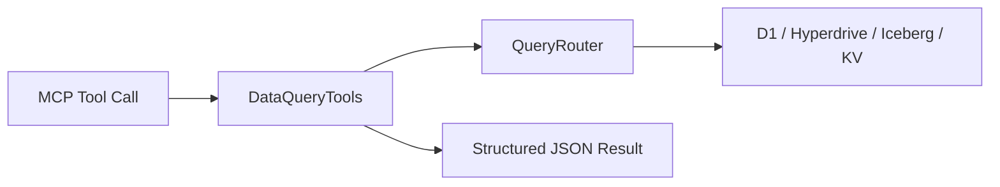

# Agent Data Query Tools

MCP data-query tools provide natural-language-accessible operational analytics through the federated query layer.

## Tools

- `query_compilation_stats`

  - input: `timeRange`, optional `groupBy`
- `query_source_health`

  - input: optional `sourceId`, `limit`
- `query_filter_changes`

  - input: `since`, optional `sourceId`
- `query_threat_intel`

  - input: optional `domain`, `ip`, `since`
- `query_system_metrics`

  - input: `metric`, `timeRange`

## Result Shape

All handlers return:

- `ok`
- `rows`
- `rowCount`
- `source`
- optional `error`

## Extension Guide

1. Add a typed args interface.
2. Add handler in `createDataQueryTools`.
3. Wire handler into MCP dispatch.
4. Update this doc with params + examples.
