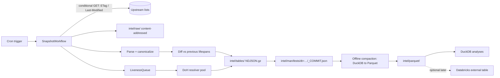

# Filter List Intelligence — Design

<strong>Status:</strong> Draft proposal — not implemented.
<strong>Companion:</strong> [Edge Data Export Policy](/security/edge-data-export-policy) (governs anything that leaves the Cloudflare boundary).

Bloqr compiles many upstream filter lists into one. Today it knows how to *combine* lists but not *which lists are worth combining*. This document designs an offline, batch pipeline that answers that: which lists are redundant, how fast each one churns, how much of each one is dead, and how reliable each upstream is. The results can feed product features (list recommendations, quality scores) and decide whether a heavier platform such as Databricks is ever justified.

The pipeline is deliberately small. The input is public list content, so there are no user data and no privacy exposure in the core design.

## Starting point: what exists today

Verified by reading the repository (static search; not a production audit).

| Finding | Evidence | Consequence for this design |
| --- | --- | --- |
| Four analytics tables are defined: `compilation_events`, `source_health`, `filter_rule_changes`, `threat_intel_hits`. | `src/analytics/tables/*.ts` | `filter_rule_changes` already models rule deltas (`ruleHash`, `changeType`). We extend that idea rather than invent a new one. |
| Nothing in `worker/` or `src/` calls `AnalyticsCatalogService.record*()` or `appendRecord()`. Only the admin query path (`createAdminQueryRouter`) and an agent type reference it. | `grep` over non-test sources | The four tables are very likely empty in production. Treat the catalog as unproven, not as a data source. |
| The "Iceberg" catalog is Iceberg-*inspired* JSONL plus JSON manifests, not the Iceberg table format. | `docs/analytics/ICEBERG_CATALOG.mdx`, `IcebergCatalog.ts` | Databricks/Spark/DuckDB cannot open it as an Iceberg table. It can still be read as JSONL if you honour the snapshot manifest. |
| `appendRecord` writes one object per record and rewrites the full `dataFiles` list into each new snapshot. It reads the parent snapshot, then writes, with no compare-and-swap. | `IcebergCatalog.ts:451-486` | Write cost grows with table size, there is a small-files problem, and concurrent writers can lose updates. Unsuitable for bulk ingest. |
| `METRICS_PIPELINE` has recorded zero events since 2026-03-07. | `wrangler.toml:538` | Another unwired telemetry path. Fix or remove it before building more. |
| `AnalyticsService.hashIp` is a 32-bit, unsalted, non-cryptographic string hash. | `src/services/AnalyticsService.ts:589-598` | Not a privacy control (see the export policy). Irrelevant to the core design below, which stores no IPs, but it blocks any user-level export. |

<strong>Design decision:</strong> the new pipeline does *not* write through `R2IcebergCatalog`. It writes immutable, partitioned files under its own R2 prefix and commits each daily run with a single manifest object. That avoids the catalog's write amplification and race conditions, and it needs no new service.

## Goals and non-goals

**Goals**

1. A daily, reproducible snapshot of every registered upstream list.
2. Rule-level history (when each rule appeared and disappeared in each list).
3. A small set of decision-grade metrics per list, queryable with plain SQL.
4. A storage format any engine can read later (DuckDB now; Spark/Databricks if ever needed).

**Non-goals**

- Per-user or per-request analytics (see the export policy).
- Replacing the compiler's own deduplication transformation.
- Real-time anything. Daily batch is enough.

## Architecture



Components, all of which already exist as platform primitives in this repo:

- <strong>Cron trigger and Workflow.</strong> `wrangler.toml` already has `[triggers]` and a Workflows pattern (`worker/workflows/`). One new `SnapshotWorkflow` fans out per source, with per-source steps so one slow upstream cannot fail the run.
- **Queues** for the liveness fan-out, because a single invocation's subrequest budget is far smaller than the domain count.
- **R2** (`ANALYTICS_CATALOG` bucket, new `intel/` prefix) for all output.
- **Compaction** runs outside the request path: a Cloudflare Container (`[[containers]]` already exists) or a scheduled CI job running DuckDB. It is the only component that needs a non-Worker runtime.

## R2 layout

Hive-style partitions so DuckDB, Spark and Databricks all prune without extra metadata.

```text
intel/
  registry/sources.json                         # versioned source registry (see below)
  raw/source_id=<id>/dt=YYYY-MM-DD/<sha256>.txt.gz
  tables/
    list_snapshots/dt=YYYY-MM-DD/part-<n>.ndjson.gz
    rule_events/dt=YYYY-MM-DD/source_id=<id>/part-<n>.ndjson.gz
    domain_liveness/dt=YYYY-MM-DD/part-<n>.ndjson.gz
  manifests/dt=YYYY-MM-DD/_COMMIT.json          # written last; defines what a reader may see
  parquet/<table>/dt=YYYY-MM-DD/…               # compacted, query-optimised copy
```

<strong>Commit protocol.</strong> Readers only trust a `dt` partition that has a `_COMMIT.json`. The file lists every object in the run with its byte size and SHA-256, plus row counts per table. Because it is written last and only once, readers never see partial runs, and no table-level compare-and-swap is needed. A rerun for the same `dt` overwrites objects idempotently (keys are deterministic) and then rewrites the manifest.

<strong>Content-addressing.</strong> Raw bodies are keyed by SHA-256. If a list has not changed, the run records a `list_snapshots` row pointing at the existing object and stores nothing new.

## Source registry

The pipeline only fetches sources in a registry. This is also the allowlist the export policy relies on.

| Field | Purpose |
| --- | --- |
| `source_id` | Stable slug, e.g. `easylist`. |
| `url_canonical` | The fetch URL with no credentials, query or fragment. |
| `dialect` | `abp`, `ubo`, `adguard`, `hosts`, `domains`. Drives the parser. |
| `public` | `true` only for lists anyone can fetch. Private user sources are never registered. |
| `license` | SPDX id or `unknown`. |
| `redistributable` | Whether derived datasets containing list content may be shared outside Bloqr. Defaults to `false` until reviewed. |
| `expected_update_hours` | Freshness SLO used by the quality metrics. |

Licences vary across popular lists (permissive, share-alike copyleft, non-commercial). Storing lists internally for analysis is a different question from redistributing them, so `redistributable` gates any outbound sharing.

## Table schemas

All timestamps are UTC ISO-8601. Types are logical; the Parquet compaction maps them to native types.

### `list_snapshots` — one row per source per run

| Column | Type | Notes |
| --- | --- | --- |
| `snapshot_id` | string | UUIDv7. |
| `dt` | date | Partition. |
| `source_id` | string | FK to registry. |
| `fetched_at` | timestamp |  |
| `http_status` | int |  |
| `not_modified` | bool | `true` when the upstream returned 304. |
| `etag`, `last_modified` | string | For the next conditional GET. |
| `content_sha256` | string | Points at `raw/`. |
| `bytes` | bigint |  |
| `rule_count` | int | After parsing. |
| `parse_error_count` | int |  |
| `header_version`, `header_expires` | string | From the list header comments when present. |
| `error_code` | string | Enum such as `TIMEOUT`, `HTTP_5XX`, `PARSE_FAIL`. Never free text. |

### `rule_events` — the system of record for rule history

One row per rule *transition*, not per rule per day. This is the delta model that `filter_rule_changes` already points towards.

| Column | Type | Notes |
| --- | --- | --- |
| `dt` | date | Partition. |
| `source_id` | string | Partition. |
| `rule_hash` | string | SHA-256 hex of the canonical rule text (see below). |
| `event` | string | `added` or `removed`. |
| `rule_kind` | string | `network_block`, `network_allow`, `cosmetic`, `scriptlet`, `host`. |
| `anchor_domain` | string | Registrable domain (eTLD+1) when the rule is domain-anchored, else null. |
| `canonical_text` | string | Stored so that hashes can be explained. Public data only. |

Why events instead of daily membership: a daily full copy of 50 lists is millions of rows per day, almost all of them unchanged. Events scale with churn, not with list size. Any point-in-time membership is reconstructable:

```sql
-- rules present in a list on a given day
SELECT rule_hash
FROM (
  SELECT rule_hash,
         arg_max(event, dt) AS last_event
  FROM rule_events
  WHERE source_id = 'easylist' AND dt <= DATE '2026-10-01'
  GROUP BY rule_hash
)
WHERE last_event = 'added';
```

A weekly **checkpoint** (a full membership dump per source) bounds the replay cost and is the integrity check: replaying events up to a checkpoint must reproduce it exactly, or the run fails.

**Canonicalization** (must be specified before the first run, because it defines identity): trim whitespace, drop comments and blank lines, normalize line endings, lowercase only the parts of a rule that are case-insensitive for its dialect, and keep modifier order as written. Two lists that express the same rule differently will not match; that is a known limitation and a possible later improvement (semantic normalization).

### `domain_liveness` — one row per domain checked

| Column | Type | Notes |
| --- | --- | --- |
| `dt` | date | Partition. |
| `domain` | string | Registrable domain from public list rules. |
| `rcode` | string | `NOERROR`, `NXDOMAIN`, `SERVFAIL`, `TIMEOUT`. |
| `has_address` | bool | A or AAAA present. |
| `resolver` | string | Which resolver answered. |

A domain is "dead" for reporting when it returns `NXDOMAIN` on at least *N* consecutive checks across at least *M* days (proposed N=3, M=14, to ride out transient failures). `SERVFAIL` and timeouts never count as dead.

<strong>Sampling.</strong> Assume on the order of low millions of distinct anchor domains across all lists (an estimate to confirm in phase 1). Checking all of them daily is unnecessary. Use a rotating schedule so each domain is rechecked about every two weeks, roughly one-fourteenth of the set per day, fanned out through Queues in batches. The only data sent to the resolver is public domain names taken from public lists.

### Existing tables reused

- `source_health` supplies upstream uptime and latency. It needs its writer wired up first (currently uncalled).
- `compilation_events` is not needed by this pipeline.

## Derived metrics (gold layer)

Computed in SQL from the tables above; no extra storage required at this scale.

| Metric | Definition | Answers |
| --- | --- | --- |
| Churn | (added + removed) in a window ÷ rule count at window start | Is this list actively maintained? |
| Freshness | Hours since the last content change vs `expected_update_hours` | Is it stale? |
| Exclusive rules | Rules present in exactly one list | What would I lose by dropping it? |
| Containment | \|A ∩ B\| ÷ \|A\| for a pair of lists | Is A redundant given B? |
| Dead ratio | Dead anchored rules ÷ anchored rules | How much of this list is dead weight? |
| Parse-error rate | `parse_error_count` ÷ lines | Is the list malformed for our parser? |
| Upstream reliability | Non-`healthy` share of `source_health` | Can we depend on it? |

## First analyses

All are plain DuckDB over R2. Run them manually first; productize only the ones that change a decision.

DuckDB reads R2 through its S3-compatible endpoint:

```sql
INSTALL httpfs; LOAD httpfs;
CREATE SECRET r2 (
  TYPE r2,
  KEY_ID '<read-only token id>',
  SECRET '<read-only token secret>',
  ACCOUNT_ID '<cloudflare account id>'
);
```

Use a read-only R2 token scoped to the `intel/` prefix, never a general-purpose key.

<strong>A. Churn and freshness (last 30 days)</strong>

```sql
SELECT source_id,
       count(*) FILTER (WHERE event = 'added')   AS added,
       count(*) FILTER (WHERE event = 'removed') AS removed
FROM read_parquet('r2://bloqr-backend-analytics-catalog/intel/parquet/rule_events/dt=*/*/*.parquet', hive_partitioning = true)
WHERE dt >= current_date - INTERVAL 30 DAY
GROUP BY source_id
ORDER BY added + removed DESC;
```

<strong>B. Redundancy: which lists are mostly contained in another?</strong>

```sql
WITH current_rules AS (
  SELECT source_id, rule_hash
  FROM (
    SELECT source_id, rule_hash, arg_max(event, dt) AS last_event
    FROM rule_events GROUP BY source_id, rule_hash
  ) WHERE last_event = 'added'
),
sizes AS (SELECT source_id, count(*) AS n FROM current_rules GROUP BY 1)
SELECT a.source_id AS list_a, b.source_id AS list_b,
       count(*) / any_value(s.n)::DOUBLE AS containment_of_a_in_b
FROM current_rules a
JOIN current_rules b USING (rule_hash)
JOIN sizes s ON s.source_id = a.source_id
WHERE a.source_id <> b.source_id
GROUP BY a.source_id, b.source_id
HAVING containment_of_a_in_b >= 0.95
ORDER BY containment_of_a_in_b DESC;
```

**C. Marginal value: exclusive rules per list**

```sql
SELECT source_id, count(*) AS exclusive_rules
FROM current_rules
WHERE rule_hash IN (SELECT rule_hash FROM current_rules GROUP BY 1 HAVING count(*) = 1)
GROUP BY source_id
ORDER BY exclusive_rules;
```

**D. Dead weight**

```sql
WITH dead AS (
  SELECT domain
  FROM domain_liveness
  WHERE dt >= current_date - INTERVAL 14 DAY
  GROUP BY domain
  HAVING count(*) >= 3 AND count(*) = count(*) FILTER (WHERE rcode = 'NXDOMAIN')
)
SELECT r.source_id,
       count(*) FILTER (WHERE d.domain IS NOT NULL) / count(*)::DOUBLE AS dead_ratio
FROM current_rules cr
JOIN rules_dim r USING (rule_hash)
LEFT JOIN dead d ON d.domain = r.anchor_domain
WHERE r.anchor_domain IS NOT NULL
GROUP BY r.source_id
ORDER BY dead_ratio DESC;
```

(`rules_dim` is a view over the latest `canonical_text`/`anchor_domain` per `rule_hash`, built by the compaction job.)

<strong>E. Allow/block conflicts.</strong> Join `network_block` and `network_allow` rules that share an `anchor_domain` across different lists to surface cases where one list's exception undoes another's block. This feeds a conflict-resolution hint in the compiler UI, not an automatic rewrite.

## Scale and when Databricks becomes worth it

These are estimates to be replaced by measurements after phase 1.

- Events scale with churn. Assume tens of thousands of event rows per day across all lists; the multi-year total is in the low hundreds of millions of rows at most, which is single-digit GB as Parquet.
- Raw bodies dominate storage and are deduplicated by content hash.
- At that size DuckDB on one machine is faster and cheaper than a cluster.

Adopt Databricks only on a measurable trigger:

| Trigger | Threshold (proposed) |
| --- | --- |
| Compressed analytical data | Exceeds roughly 200 GB, or any query exceeds a few minutes on a single large node |
| New consumer | A customer or partner requires Delta Sharing or Marketplace delivery |
| New workload | Rule-level ML (classification, embeddings) that benefits from managed GPUs, Vector Search or Unity Catalog governance |

Because the tables are hive-partitioned Parquet in object storage, adoption is a registration step, not a rewrite. Whether Unity Catalog can use R2 as an external location directly is **unverified**; the fallback is a scheduled copy to the workspace's cloud storage, which is also where the export policy applies.

## Delivery plan

| Phase | Deliverable | Exit criterion |
| --- | --- | --- |
| 0 | Resolve prerequisites: decide on `METRICS_PIPELINE`; wire or drop `recordSourceHealth`; fix `hashIp`. | No dead telemetry bindings; export policy findings addressed. |
| 1 | Source registry, `SnapshotWorkflow`, raw store, `list_snapshots`, commit manifest. | 7 consecutive daily commits; re-running a day is a no-op; a 304 stores nothing. |
| 2 | Parser + canonicalizer, `rule_events`, weekly checkpoint with replay verification. | Replay reproduces every checkpoint exactly. |
| 3 | `domain_liveness` via Queues and the resolver pool. | Full coverage of the domain set within the rotation window; zero sustained `SERVFAIL` bias. |
| 4 | DuckDB compaction to Parquet; analyses A–E; written findings. | A short report that names at least one product decision the data changes (or concludes it does not). |
| 5 | Decision gate against the Databricks triggers above. | Documented go/no-go. |

Tests follow repo rules: Deno unit tests co-located, `makeEnv()` fixtures with in-memory R2/KV stubs, no real bindings. The parser and canonicalizer need golden-file tests per dialect, because rule identity depends on them.

## Risks and open questions

- <strong>Parser fidelity.</strong> A canonicalizer bug silently corrupts every downstream metric. Golden tests and the checkpoint replay check are the mitigation.
- <strong>Upstream etiquette.</strong> Daily conditional GETs for dozens of lists are cheap, but honour `Retry-After`, cache validators and any published fetch guidance.
- <strong>Resolver dependency.</strong> DoH quotas and rate limits apply. The resolver pool should be pluggable and the sampling rate configurable.
- <strong>Licensing.</strong> `redistributable` must be reviewed per source before any dataset leaves Bloqr.
- <strong>Value uncertainty.</strong> The analyses may show the lists are already well-curated and there is little to act on. Phase 4 is built to answer exactly that before anything heavier is bought.
