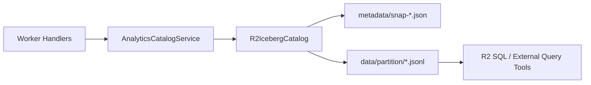

# Iceberg-Style R2 Analytics Catalog

The analytics catalog introduces an Apache Iceberg-inspired layout on top of Cloudflare R2 so bloqr events can be stored with snapshot isolation and queried as analytical tables.



## Layout

- Metadata: `iceberg/{tableName}/metadata/snap-{snapshotId}.json`
- Data: `iceberg/{tableName}/data/{partition}/{uuid}.jsonl`
- Pointer: `iceberg/{tableName}/metadata/table.json`

## Built-in Tables

- `compilation_events`
- `threat_intel_hits`
- `filter_rule_changes`
- `source_health`

Each table exports:

- `TABLE_NAME`
- `PARTITION_SPEC`
- schema/input types
- `toRecord()` serializer

## Partition Strategy

Default partition specs prioritize time + cardinality controls:

- compilation: `date/eventType/sourceId`
- threat intel: `date/indicatorType/sourceId`
- filter changes: `date/sourceId/changeType`
- source health: `date/sourceId/healthStatus`

## Snapshot Operations

`R2IcebergCatalog` supports:

- append
- query
- compact
- snapshot listing
- rollback
- old snapshot expiry

## R2 SQL Query Example

```sql
SELECT date, status, COUNT(*) AS total
FROM iceberg.compilation_events
WHERE date >= '2026-01-01'
GROUP BY date, status;
```

## Adding a New Table

1. Add `src/analytics/tables/MyTable.ts` with schema + `toRecord`.
2. Register definition in catalog bootstrap.
3. Add high-level write method in `AnalyticsCatalogService`.
4. Document query patterns and partition rationale.
