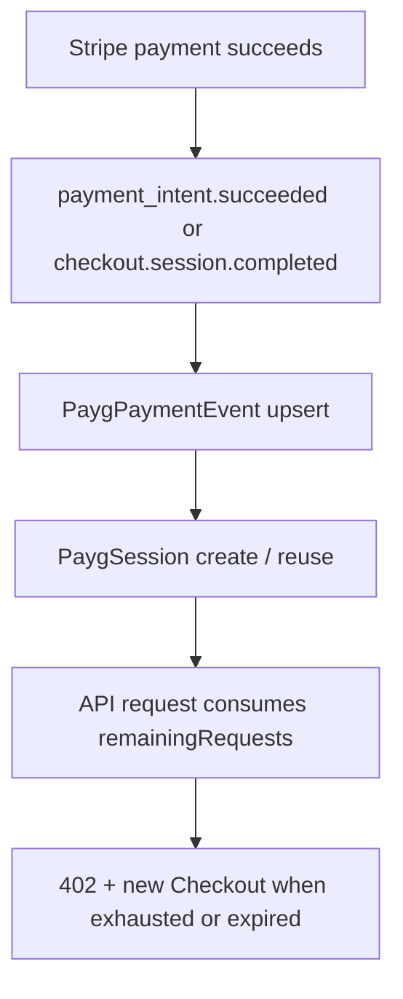

# Pay As You Go (PAYG) — Developer Guide

PAYG lets developers purchase API access through Stripe Checkout and convert that completed payment into a short-lived API session.

---

## Quick Start

### 1\. Check current pricing

```bash
curl https://api.bloqr.dev/api/payg/pricing
```

### 2\. Create a Checkout Session

```bash
curl -X POST https://api.bloqr.dev/api/stripe/payg/checkout \
  -H 'Content-Type: application/json' \
  -d '{ "requestsToPurchase": 10 }'
```

Response:

```json
{
  "success": true,
  "checkoutUrl": "https://checkout.stripe.com/...",
  "sessionId": "cs_test_..."
}
```

### 3\. Exchange the completed payment for a PAYG session

After Checkout redirects back to the app, send the completed Checkout Session ID or PaymentIntent ID to the authenticated session-creation endpoint:

```bash
curl -X POST https://api.bloqr.dev/api/payg/session/create \
  -H 'Content-Type: application/json' \
  -H 'Cookie: better-auth.session_token=<your-session-token>' \
  -d '{ "checkoutSessionId": "cs_test_..." }'
```

Response:

```json
{
  "success": true,
  "sessionToken": "payg_...",
  "requestsGranted": 10,
  "expiresAt": "2026-05-27T23:00:00.000Z"
}
```

### 4\. Use the PAYG session

```bash
curl https://api.bloqr.dev/api/compile \
  -H 'X-Payg-Session: payg_...' \
  -H 'Content-Type: application/json' \
  -d '{ ... }'
```

The response includes `X-Payg-Session-Remaining`.

### 5\. Check authenticated usage totals

```bash
curl https://api.bloqr.dev/api/payg/usage \
  -H 'Cookie: better-auth.session_token=<your-session-token>'
```

---

## x402 Protocol

Endpoints protected by `paygMiddleware()` follow the [x402 protocol](https://x402.org):

1. **Without a session**: the API returns `402 Payment Required` with a JSON body plus `X-Payment-Required`.
2. <strong>With `X-Payment-Response`</strong>: the middleware verifies the Stripe payment proof, issues or reuses the deterministic PAYG session, consumes one request, and continues the request.
3. <strong>With `X-Payg-Session`</strong>: the middleware validates the session, decrements usage, and returns `X-Payg-Session-Remaining`.

### Payment specification shape

```json
{
  "version": "2",
  "scheme": "exact",
  "network": "stripe",
  "maxAmountRequired": "1",
  "resource": "price_...",
  "description": "Pay As You Go - $0.01 per API call",
  "mimeType": "application/json",
  "outputSchema": null,
  "extra": {
    "stripePublishableKey": "pk_live_...",
    "checkoutUrl": "https://api.bloqr.dev/api/stripe/payg/checkout",
    "sessionRequestsGranted": 10,
    "sessionTtlSeconds": 3600
  }
}
```

---

## Session Lifecycle

PAYG sessions are intentionally deterministic per PaymentIntent:

- A successful Stripe payment creates or reuses exactly one `PaygSession`.
- Replaying the same `paymentIntentId` or `checkoutSessionId` returns the same session token instead of minting unbounded access.
- Sessions expire after one hour unless exhausted earlier.



---

## Usage Accounting

`GET /api/payg/usage` returns:

- `totalRequests` / `totalSpendUsdCents` from `PaygCustomer`
- `thisMonthRequests` / `thisMonthSpendUsdCents` from current-month `PaygPaymentEvent` rows
- `conversionEligible` once cumulative spend crosses `PAYG_CONVERSION_THRESHOLD_USD_CENTS`

This makes PAYG upsell prompts deterministic and keeps monthly reporting tied to Stripe payment events.

---

## Database Models

### `PaygCustomer`

Stripe customer-level running totals for PAYG usage.

### `PaygPaymentEvent`

Append-only reconciliation log keyed by `stripePaymentIntentId`.

### `PaygSession`

Opaque API session token used by `X-Payg-Session`.

### `BillingUsageEvent`

General usage ledger for rolling 30-day billing and future Stripe metering exports.

---

## Related Documentation

- [Billing Overview](/billing/readme)
- [Stripe Setup Guide](/billing/stripe-setup)
