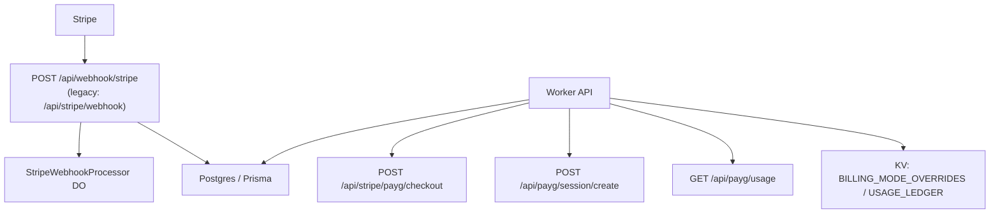

# Billing Overview

Bloqr supports three complementary billing paths:

1. **Personal subscriptions** — monthly auto-pay with a 7-day base-plan trial.
2. **Business / organization billing** — monthly auto-pay or invoice terms, with Cloudflare consumption pass-through for invoiced orgs.
3. <strong>Pay As You Go (PAYG)</strong> — per-call billing through Stripe Checkout with short-lived API sessions.

---

## Billing Models

### Pay As You Go (PAYG)

PAYG is designed for low-volume or occasional API access. A completed Stripe payment is converted into a deterministic `PaygSession`, which is then sent in `X-Payg-Session`.

| Property | Value |
| --- | --- |
| Price per call | Configurable via `PAYG_PRICE_PER_CALL_USD_CENTS` (default: $0.01) |
| Session size | 10 calls per payment by default, or the purchased Stripe quantity |
| Session TTL | 1 hour |
| Rate limit | 120 req/min, 500 req/day |
| Max rules per list | 50,000 |
| Max sources per compile | 5 |
| Retention | 7 days |

PAYG uses the [x402 protocol](https://x402.org) for machine-readable payment negotiation:

- <strong>`X-Payment-Required`</strong> — sent by the server in 402 responses with the payment specification.
- <strong>`X-Payg-Session`</strong> — sent by the client in subsequent requests once a session is purchased.

#### Session Flow

```
Client                          Server
  |                               |
  |-- GET /api/compile ---------->|
  |<-- 402 Payment Required -------|
  |   X-Payment-Required: {...}   |
  |                               |
  |-- POST /stripe/payg/checkout ->|
  |<-- { checkoutUrl } ------------|
  |                               |
  |-- (completes Stripe Checkout) |
  |-- POST /payg/session/create -->|
  |   { checkoutSessionId }        |
  |<-- { sessionToken } -----------|
  |                               |
  |-- GET /api/compile ----------->|
  |   X-Payg-Session: <token>     |
  |<-- 200 OK ---------------------|
  |   X-Payg-Session-Remaining: 9 |
```

### Subscription Plans

| Plan | Trial | Rate Limit | Daily Limit | Features |
| --- | --- | --- | --- | --- |
| Free | — | 60 req/min | — | Basic compilation |
| Pro | 7 days | 300 req/min | 10,000/day | AST storage, webhooks, version history |
| Vendor | 7 days | 600 req/min | 50,000/day | All Pro + translation, CDN distribution |
| Enterprise | 7 days | Unlimited | Unlimited | All Vendor + dedicated SLA |

Add-ons are modelled as separate Stripe products / prices with shorter 1–2 day trials. Product metadata must mirror `SubscriptionPlan` feature flags and `SUBSCRIPTION_TIER_LIMITS`.

---

## Architecture



---

## Environment Variables

| Variable | Type | Description |
| --- | --- | --- |
| `STRIPE_PUBLISHABLE_KEY` | Non-secret | Live Stripe publishable key (safe for frontend) |
| `STRIPE_SECRET_KEY` | Secret | Live Stripe secret key |
| `STRIPE_WEBHOOK_SECRET` | Secret | Live webhook signing secret |
| `STRIPE_TEST_SECRET_KEY` | Secret | Sandbox Stripe secret key |
| `STRIPE_TEST_WEBHOOK_SECRET` | Secret | Sandbox webhook signing secret |
| `STRIPE_BILLING_MODE` | Non-secret | Default request billing mode (`live` or `sandbox`) |
| `BILLING_MODE_OVERRIDES` | KV | Per-user / per-org live vs sandbox overrides |
| `USAGE_LEDGER` | KV | Rolling usage counters for Stripe metering aggregation |
| `STRIPE_PAYG_PRICE_ID` | Non-secret | Stripe Price ID for PAYG checkout |
| `PAYG_PRICE_PER_CALL_USD_CENTS` | Non-secret | Price per API call (default: 1) |
| `PAYG_CONVERSION_THRESHOLD_USD_CENTS` | Non-secret | Upsell threshold (default: 2000 = $20) |

Mode resolution happens in `worker/services/stripe-service.ts`:

1. Check `BILLING_MODE_OVERRIDES` using the org ID, then the user ID.
2. Fall back to `STRIPE_BILLING_MODE`.
3. Select the matching live or sandbox Stripe keys for the request.

`wrangler.toml` defines `[env.staging]` with `STRIPE_BILLING_MODE = "sandbox"` so a single deployment can default staging traffic to Stripe test mode.

---

## Database Additions

Billing state is persisted in:

- `StripeProductCache` — Stripe product / price read cache for pricing UX.
- `BillingUsageEvent` — append-only API usage ledger.
- `CloudflareUsageSnapshot` — Cloudflare pass-through usage for invoiced orgs.
- `BillingModeOverride` — persisted source of truth for live / sandbox overrides.
- `PaygCustomer`, `PaygPaymentEvent`, `PaygSession` — PAYG customer, payment, and session state.

---

## Related Documentation

- [PAYG Developer Guide](/billing/payg)
- [Stripe Setup Guide](/billing/stripe-setup)
