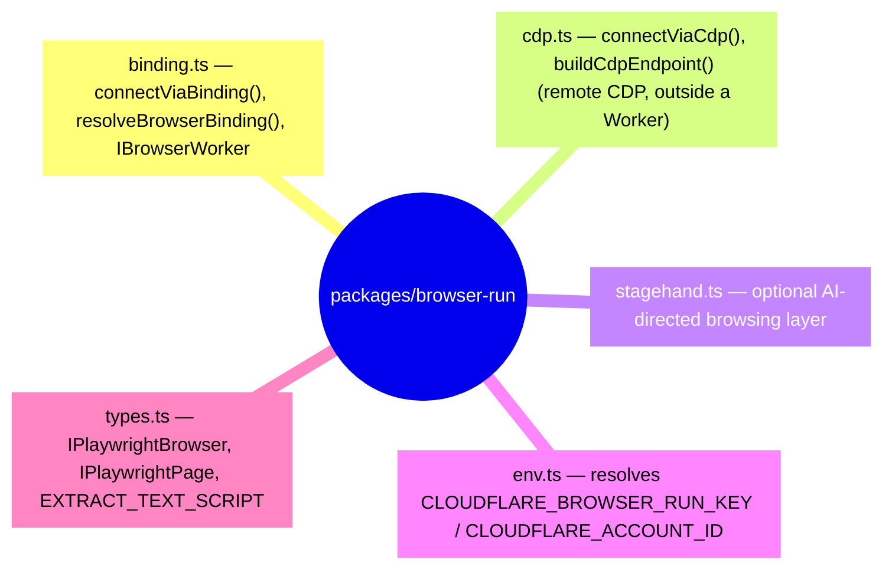

# Browser Run Integration

This document describes the Cloudflare Browser Run integration in bloqr-backend.
Browser Run allows the worker to spin up a full Chromium instance to fetch filter-list
sources that require JavaScript execution, navigate redirect chains, or run behind bot-detection
walls that defeat a plain `fetch()`.

> <strong>What changed?</strong> Cloudflare rebranded "Browser Rendering" to **Browser Run** and rebuilt
> the service on top of Cloudflare Containers. The `[browser]` binding API and
> `@cloudflare/playwright` package are **unchanged** — no code changes are required.

---

## Binding Configuration

Add the `BROWSER` binding to `wrangler.toml`:

```toml
[browser]
binding = "BROWSER"
```

The binding type is `Fetcher` (Cloudflare's internal `cloudflare:workers` `WorkerEntrypoint`
type). The `@cloudflare/playwright` package wraps it into a Playwright-compatible API.

---

## Architecture

### Two mirrored implementations, split by JSR publish boundary

`packages/browser-run` (published locally as `@bloqr/browser-run`) is the source of truth for
everything **outside** `src/`: `worker/handlers/browser.ts`, `frontend/e2e`, CI/CD, agent
sessions, and any future consumer. It's written with no dependency on `worker/` or `src/` so it
can be extracted into its own repository later without changes.



`src/platform/BrowserFetcher.ts` is the one exception: it's part of the JSR-published
`@bloqr/compiler` package (`deno.json`'s `publish.include` only covers `src/**/*.ts`), so it
cannot import `packages/browser-run` — doing so would pull a local npm-only workspace package
into the JSR module graph and fail `deno publish --dry-run`'s excluded-module check. It instead
defines the same structural types (`IPlaywrightBrowser`, `IPlaywrightPage`, `IBrowserWorker`,
`BrowserConnector`, `EXTRACT_TEXT_SCRIPT`) locally, by design mirroring `@bloqr/browser-run`'s
shape so a `connectViaBinding` from the package satisfies `BrowserFetcher`'s constructor without
any adapter. See `packages/browser-run/README.md` for the full API and the rationale for
choosing CDP as the transport and Playwright as the default client on top of it.

### Dynamic Import

`@cloudflare/playwright` imports `cloudflare:workers` at module level. Loading it statically
crashes Deno's test runner. `@bloqr/browser-run`'s binding connector therefore loads it lazily:

```typescript
// packages/browser-run/src/binding.ts
const { launch } = await import('@cloudflare/playwright');
const browser = await launch(binding);
```

This keeps the module out of Deno's static graph during `deno task check` and `deno task test`
— confirmed by `deno.json`'s import map, which points the bare specifier `@bloqr/browser-run`
directly at `./packages/browser-run/src/index.ts` so Deno can resolve it (for `worker/` and any
other non-JSR-published module) without going through node\_modules.

---

## Worker Endpoints

All three endpoints require the caller to be authenticated with a Bearer token.

### `POST /api/browser/resolve-url`

Navigates to a URL and returns the final canonical URL after all redirects.

**Request body**

```jsonc
{
    "url": "https://example.com/short-link",   // required
    "waitUntil": "networkidle"                 // optional, see §waitUntil Options
}
```

<strong>Response `200`</strong>

```jsonc
{
    "success": true,
    "resolvedUrl": "https://example.com/final-destination",
    "originalUrl": "https://example.com/short-link"
}
```

<strong>Use case:</strong> Discover the true destination of a redirect chain before scheduling a
filter-list download. Saves bandwidth on subsequent compilation runs.

---

### `POST /api/browser/monitor`

Performs parallel browser-based health checks on a list of filter-list source URLs.
For each URL the handler navigates with a headless browser, verifies non-empty text
content, and optionally captures a full-page PNG screenshot stored in R2.

The full result set is persisted to the KV key `browser:monitor:latest` so it can be
retrieved later without re-running the checks.

**Request body**

```jsonc
{
    "urls": [                                   // required, 1–10
        "https://example.com/filter-list.txt",
        "https://another.example.com/rules.txt"
    ],
    "captureScreenshots": false,               // optional — store a PNG per URL in R2
    "screenshotPrefix": "2025-07-01",          // optional — R2 key prefix (default: ISO date)
    "timeout": 30000,                          // optional — per-URL timeout in ms
    "waitUntil": "networkidle"                 // optional, see §waitUntil Options
}
```

<strong>Response `200`</strong>

```jsonc
{
    "success": true,
    "total": 2,
    "reachable": 1,
    "unreachable": 1,
    "results": [
        {
            "url": "https://example.com/filter-list.txt",
            "reachable": true,
            "checkedAt": "2025-07-01T12:00:00.000Z",
            "screenshotKey": "2025-07-01/a1b2c3d4e5f6.png"
        },
        {
            "url": "https://another.example.com/rules.txt",
            "reachable": false,
            "error": "net::ERR_NAME_NOT_RESOLVED",
            "checkedAt": "2025-07-01T12:00:01.000Z"
        }
    ]
}
```

`screenshotKey` is only present when `captureScreenshots` is `true` and `FILTER_STORAGE`
is configured. When a URL cannot be fetched, the result entry contains an `error` field
and `reachable` is `false`.

<strong>Required bindings:</strong> `BROWSER`
<strong>Optional bindings:</strong> `FILTER_STORAGE` (R2 for screenshots), `COMPILATION_CACHE` (KV for persistence)

---

### `GET /api/browser/monitor/latest`

Returns the most recent result set written by `POST /api/browser/monitor`. Useful for polling
or dashboards that need to display change status without triggering new browser navigations.

<strong>Response `200`</strong> — same shape as `POST /api/browser/monitor`

<strong>Response `404`</strong> — no monitor run has been persisted yet

<strong>Required binding:</strong> `COMPILATION_CACHE`

---

## `waitUntil` Options

All browser endpoints accept an optional `waitUntil` field that controls when Playwright
considers a page navigation complete.

| Value | Description |
| --- | --- |
| `load` | Fires when the `load` DOM event fires. Fastest; suitable for static pages. |
| `domcontentloaded` | Fires when the `DOMContentLoaded` event fires. |
| `networkidle` | <strong>(default)</strong> Waits until no network connections for 500 ms. Best for SPA-heavy pages. |

---

## `ISource.useBrowser` Flag

Set `useBrowser: true` on any source in a `WorkerCompiler` configuration to route that
source's download through `BrowserFetcher` instead of the standard HTTP fetcher:

```typescript
import { WorkerCompiler } from '@bloqr/compiler';
import { connectViaBinding } from '@bloqr/browser-run';

const compiler = new WorkerCompiler({
    fetcher: httpFetcher,
    browserConnector: connectViaBinding,
    browserBinding: env.BROWSER,
});

const result = await compiler.compile({
    sources: [
        {
            source: 'https://example.com/plain-list.txt',
        },
        {
            source: 'https://js-heavy-site.example.com/rules',
            useBrowser: true,     // ← uses BrowserFetcher for this source only
        },
    ],
    // ...
});
```

When `useBrowser` is `true` but `browserConnector` or `browserBinding` are not provided to
`WorkerCompiler`, the compiler throws an error.

---

## Using `BrowserFetcher` Directly

`BrowserFetcher` is exported from the library and can be used outside the Worker:

```typescript
import { BrowserFetcher } from '@bloqr/compiler';

// In a Cloudflare Worker:
import { connectViaBinding } from '@bloqr/browser-run';

const fetcher = new BrowserFetcher(
    env.BROWSER,
    { timeout: 30_000, waitUntil: 'networkidle' },
    connectViaBinding,
);

const content = await fetcher.fetch('https://example.com/filter-list.txt');
```

---

## Remote CDP Access (CI/CD & Agents)

Everything above uses the `[browser]` binding, which only exists **inside a deployed
Worker**. Anything running outside one — CI/CD runners, coding-agent sessions, ad hoc
scripts — has no `env.BROWSER` to reach through. `@bloqr/browser-run`'s `connectViaCdp`
covers that case by connecting directly to Cloudflare Browser Run over CDP:

```typescript
import { connectViaCdp } from '@bloqr/browser-run';

const browser = await connectViaCdp();
const page = await browser.newPage();
await page.goto('https://example.com/list-that-blocks-bots.txt');
console.log(await page.content());
await browser.close();
```

### Credentials

| Variable | Used by | Purpose |
| --- | --- | --- |
| `CLOUDFLARE_BROWSER_RUN_KEY` | GitHub Actions | Cloudflare API token with Browser Rendering permissions. |
| `COPILOT_MCP_CLOUDFLARE_BROWSER_RUN_KEY` | Agent runners | Same token, read as a fallback when the first isn't set. |
| `CLOUDFLARE_ACCOUNT_ID` | Both | The account the token belongs to. |

`resolveBrowserRunCredentials()` (in `packages/browser-run/src/env.ts`) throws an actionable
error listing exactly what's missing when neither is configured.

### Where this is used today

- <strong>`frontend/e2e`</strong> — specs import `test`/`expect` from `frontend/e2e/fixtures.ts` instead of
  `@playwright/test` directly. That fixture launches a local Chromium by default and switches
  to `connectViaCdp` when the credentials above are present, with no change to the spec files
  themselves. `.github/workflows/playwright-e2e.yml` sets `CLOUDFLARE_BROWSER_RUN_KEY` /
  `CLOUDFLARE_ACCOUNT_ID` from repo secrets and skips the local-Chromium install step when
  they're set.
- Anywhere else that needs to fetch a source that blocks AI/bot traffic and isn't running
  inside a deployed Worker.

### Choosing a client (Playwright vs Puppeteer vs Stagehand vs CDP)

CDP is the transport; everything above is a choice of client on top of it. Playwright
(`connectViaCdp`) is the default — same SDK the in-Worker path uses. `connectViaCdpWithPuppeteer`
is available for tooling that specifically expects Puppeteer/raw-CDP semantics. Stagehand
(`@bloqr/browser-run/stagehand`, pinned to the `2.5.x` range Browser Run supports) layers
AI-directed, natural-language actions on top — reach for it only when a task genuinely needs
"click the thing that looks like X" rather than a fixed selector, since every action costs an
LLM call. See `packages/browser-run/README.md` for the full comparison.

Session reuse (skip the cold start on a follow-up connection) is supported via `sessionId` /
`keepAliveMs` on `connectViaCdp`'s options — see
[Reuse sessions](https://developers.cloudflare.com/browser-run/features/reuse-sessions/).

### A note for Claude / coding agents

This environment has direct access to the `Cloudflare_Browser_Run` MCP server
(`get_url_screenshot`, `get_url_markdown`, `get_url_html_content`, `start_crawl`, etc.) for
one-off fetches and troubleshooting. Prefer that over `@bloqr/browser-run` for a single
lookup — it needs no credentials wired into the session. Reach for `@bloqr/browser-run` when
you need programmatic control from code: test suites, repeated automation, or anything that
must run outside an interactive agent session. Browser Run is a billed service either way —
use it deliberately.

---

## Required Bindings Summary

| Binding | Type | Required for |
| --- | --- | --- |
| `BROWSER` | `Fetcher` | All browser navigation |
| `FILTER_STORAGE` | `R2Bucket` | Screenshot capture (`POST /api/browser/monitor` with `captureScreenshots: true`) |
| `COMPILATION_CACHE` | `KVNamespace` | Result persistence (`POST /api/browser/monitor`, `GET /api/browser/monitor/latest`) |

Both `BROWSER` and `COMPILATION_CACHE` are already declared in `worker/types.ts` (`Env` interface) and `wrangler.toml`.
