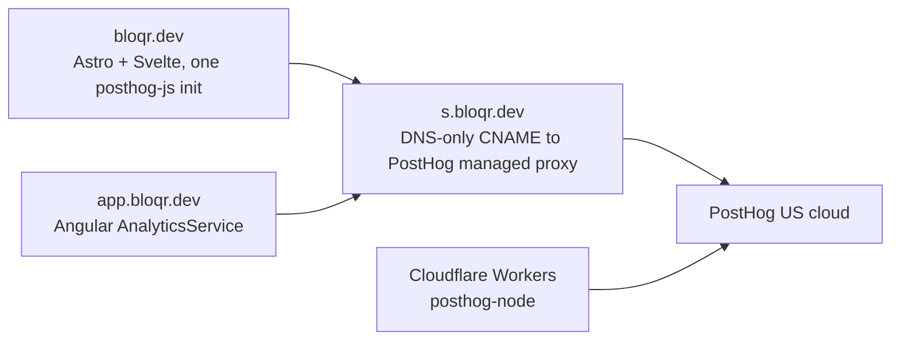

# PostHog Analytics

Product analytics for the marketing site (`bloqr.dev`, repo `bloqr-landing`) and this Angular app (`app.bloqr.dev`). One PostHog project ("Bloqr AI", US cloud) receives both. PostHog replaces Google Analytics.

## Data path

- `s.bloqr.dev` is a DNS-only (grey cloud) CNAME. Do **not** turn the Cloudflare proxy on for it. TLS for that hostname is issued on PostHog's side; our `*.bloqr.dev` certificates do not apply to it.
- Ingestion goes through our own subdomain so content blockers that list `posthog.com` do not drop events. Some blockers (AdGuard, uBlock on Firefox) follow CNAME chains; if that becomes a problem, the Worker-based proxy in `bloqr-landing/functions/posthog-proxy.ts` removes the CNAME to PostHog entirely.

## SDK choice

Pick by runtime, not by framework. No framework-specific PostHog SDK exists for Angular, Astro or Svelte; those guides are setup notes over the same packages.

| Runtime | SDK | Where |
| --- | --- | --- |
| Browser | `posthog-js`, one init per runtime | Landing: `PostHog.astro` (Svelte islands reuse it). App: `frontend/src/app/services/analytics.service.ts` |
| Worker / server | `posthog-node` | Landing `functions/` via `src/lib/posthog-server.ts`; call `waitUntil(flush)` |

Do not load PostHog through Google Tag Manager: GTM is on most blocklists, forces a looser `script-src`, and changes outside code review.

## Angular app: privacy posture

`AnalyticsService` is the only analytics seam. It loads `posthog-js` lazily, in the browser only, and:

- sends only explicit `track()` events and one `$pageview` per completed navigation (no autocapture, session replay, heatmaps, dead clicks, performance capture or surveys);
- honours Do Not Track and keeps nothing on the device (`persistence: 'memory'`), so no consent banner is needed for it;
- creates persons only after sign-in, identified by the opaque Better Auth user id, never an email, and resets on sign-out;
- strips query strings and fragments from every URL before sending (the app puts one-time values such as `?flash=` in query strings);
- leaves error reporting to Sentry.

CSP: `connect-src` allows `https://s.bloqr.dev` (in `frontend/server.ts` and `frontend/src/_headers`, kept in sync, guarded by `worker/frontend-csp.test.ts`). `script-src` stays closed because the extensions that load remote scripts are disabled. If session replay is ever enabled, `script-src` needs `https://s.bloqr.dev`.

## Operations

- Project token and ingestion host are public (see `posthog.config.ts`). The personal API key is in 1Password `Claude-Dev`, item `posthog/api/prod`.
- <strong>No data for days?</strong> Open PostHog, Settings, Managed reverse proxy, and check `s.bloqr.dev`. `curl -i https://s.bloqr.dev/static/array.js` returning `403` with body `error code: 1014` is Cloudflare's "CNAME cross-user banned" error. It is a symptom, not a diagnosis; read the status and message of the proxy in PostHog for the cause (on the old `f.bloqr.dev` record it was an expired certificate). Use **Retry** on the proxy (the API refuses personal API keys for this call, so it is a UI click). The 2026-06-27 to 2026-10-25 data gap was this failure on the original `f.bloqr.dev` record; it was replaced by `s.bloqr.dev` (new record, fresh certificate). A Grafana Synthetic Monitoring check (`bloqr-posthog-proxy`) and the warning rule `bloqr-posthog-proxy-down` now watch the host; see the [`posthog-proxy-down` runbook](https://github.com/BloqrAI/bloqr-artifacts/blob/main/grafana/runbooks/workers.md#posthog-proxy-down) in `bloqr-artifacts`.
- PostHog's outbound IPs, for allowlisting where PostHog must call into our services: `44.205.89.55`, `44.208.188.173`, `52.4.194.122`.
