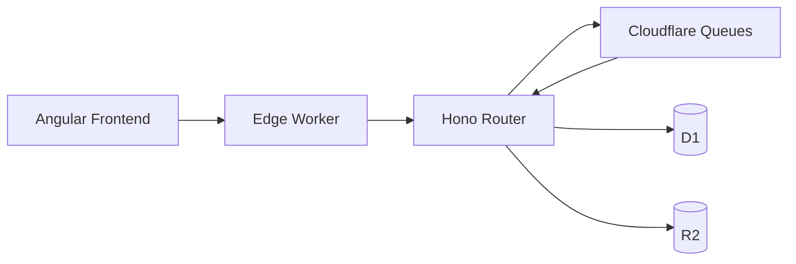

<Callout kind="tip">
  <strong>What is Bloqr?</strong>

  Bloqr AI is a compiler-as-a-service for adblock and DNS filter lists. It ingests multiple sources,
  validates configuration with Zod, applies deterministic transformations, and ships edge-ready outputs
  from Cloudflare Workers.
</Callout>

## Platform Snapshot

- **50+ Filter Sources**: Multi-source ingestion across community and managed lists.
- **11 Transformations**: Deterministic pipeline stages for cleanup, normalization, and optimization.
- **Zero-Copy Streaming**: SSE and WebSocket delivery for live compile telemetry.
- **Edge-Native Runtime**: Cloudflare Workers, Queues, D1, R2, and Workflows by default.

## Start in Minutes

1. Open [Quick Start](/guides/quick-start) and choose Docker, Deno, or Workers mode.
2. Validate your config with [Zod Validation](/api/zod-validation) and [Configuration](/usage/configuration).
3. Deploy to production with [Deployment](/deployment/readme) and [Zero Trust Architecture](/security/zero-trust-architecture).

## Section Navigation

### Getting Started

<Columns cols={2}>
  <Card title="Overview" href="/guides/readme">
    Entry point for setup, migration, and practical guides.
  </Card>

  <Card title="Quick Start" href="/guides/quick-start">
    Launch Bloqr quickly using Docker, Deno, or Cloudflare Workers.
  </Card>

  <Card title="Client Libraries" href="/guides/clients">
    Implementation examples for API consumers.
  </Card>

  <Card title="Validation Errors" href="/guides/validation-errors">
    Decode and resolve common schema validation failures.
  </Card>
</Columns>

### API

<Columns cols={2}>
  <Card title="API Overview" href="/api/readme">
    REST API entrypoint and architectural context.
  </Card>

  <Card title="Quick Reference" href="/api/quick-reference">
    High-signal commands and endpoint recipes.
  </Card>

  <Card title="Streaming API" href="/api/streaming-api">
    SSE/WebSocket compile updates.
  </Card>

  <Card title="Zod Validation" href="/api/zod-validation">
    Trust-boundary validation and request contracts.
  </Card>
</Columns>

### Cloudflare

<Columns cols={2}>
  <Card title="Cloudflare Overview" href="/cloudflare/readme">
    Platform-level integration map.
  </Card>

  <Card title="Services Overview" href="/cloudflare/cloudflare-services">
    Queues, Workflows, D1, R2, and analytics bindings.
  </Card>

  <Card title="Cloudflare Workflows" href="/cloudflare/cloudflare-workflows">
    Durable orchestration for long-running jobs.
  </Card>

  <Card title="Queue Diagnostics" href="/cloudflare/queue-diagnostics">
    Operational visibility for queue throughput and failures.
  </Card>
</Columns>

### Database

<Columns cols={2}>
  <Card title="Database Setup" href="/database-setup/readme">
    Schema, local setup, and migration strategy.
  </Card>

  <Card title="Architecture" href="/database-setup/database-architecture">
    Storage architecture and data domain boundaries.
  </Card>

  <Card title="Local Development" href="/database-setup/local-dev">
    Run Neon/Postgres-backed local workflows.
  </Card>

  <Card title="Prisma Schema Reference" href="/database-setup/prisma-schema-reference">
    Canonical DB schema and modeling details.
  </Card>
</Columns>

### Deployment

<Columns cols={2}>
  <Card title="Deployment Overview" href="/deployment/readme">
    All deployment paths and environment strategy.
  </Card>

  <Card title="Docker" href="/deployment/docker">
    Containerized local and production deployment.
  </Card>

  <Card title="Workers Architecture" href="/deployment/cloudflare-workers-architecture">
    Cloudflare-native runtime topology.
  </Card>

  <Card title="Production Readiness" href="/deployment/production-readiness">
    Checklist for secure and resilient rollouts.
  </Card>
</Columns>

### Frontend

<Columns cols={2}>
  <Card title="Frontend Overview" href="/frontend/readme">
    SPA surface, architecture, and workflows.
  </Card>

  <Card title="Angular Frontend" href="/frontend/angular-frontend">
    Angular 22 implementation details.
  </Card>

  <Card title="Validation UI" href="/frontend/validation-ui">
    User-facing validation and error visualization.
  </Card>

  <Card title="Vite" href="/frontend/vite">
    Build and dev server pipeline for frontend delivery.
  </Card>
</Columns>

### Security

<Columns cols={2}>
  <Card title="Zero Trust Architecture" href="/security/zero-trust-architecture">
    Mandatory ZTA model across edge, worker, and UI layers.
  </Card>

  <Card title="ZTA Developer Guide" href="/security/zta-developer-guide">
    Implementation guidance for secure handlers and flows.
  </Card>

  <Card title="API Shield Scanner" href="/security/api-shield-vulnerability-scanner">
    Cloudflare API Shield vulnerability scanning controls.
  </Card>

  <Card title="Page Shield Integration" href="/security/page-shield-integration">
    Client-side security telemetry and protections.
  </Card>
</Columns>

### Auth

<Columns cols={2}>
  <Card title="Auth Overview" href="/auth/readme">
    Authentication and authorization architecture.
  </Card>

  <Card title="Auth Chain Reference" href="/auth/auth-chain-reference">
    Handler auth chain order and enforcement semantics.
  </Card>

  <Card title="API Authentication" href="/auth/api-authentication">
    JWT/API key auth for API consumers.
  </Card>

  <Card title="Cloudflare Access" href="/auth/cloudflare-access">
    Zero-trust access control for protected surfaces.
  </Card>
</Columns>

### Admin

<Columns cols={2}>
  <Card title="Admin Overview" href="/admin/readme">
    RBAC, audit, and operational controls.
  </Card>

  <Card title="Roles & Permissions" href="/admin/roles-permissions">
    Role matrix and delegated access model.
  </Card>

  <Card title="Admin API Reference" href="/admin/api-reference">
    Administrative API contracts and payloads.
  </Card>

  <Card title="Operator Guide" href="/admin/operator-guide">
    Runbook for production administration.
  </Card>
</Columns>

### Testing

### Observability

<Columns cols={2}>
  <Card title="Observability Overview" href="/observability/readme">
    Monitoring stack and telemetry conventions.
  </Card>

  <Card title="Sentry Integration" href="/observability/sentry">
    Error tracking, tracing, and release visibility.
  </Card>

  <Card title="Cloudflare Native Observability" href="/observability/cloudflare-observability">
    Cloudflare-native metrics and diagnostics.
  </Card>

  <Card title="Prometheus Metrics" href="/observability/prometheus">
    Metrics export and dashboard integration.
  </Card>
</Columns>

### Troubleshooting

<Columns cols={2}>
  <Card title="Troubleshooting Overview" href="/troubleshooting/readme">
    Knowledge base and incident triage map.
  </Card>

  <Card title="KB-001: API Not Available" href="/troubleshooting/kb-001-api-not-available">
    Investigate and recover API availability incidents.
  </Card>

  <Card title="KB-002: Hyperdrive Database Down" href="/troubleshooting/kb-002-hyperdrive-database-down">
    Database outage runbook and failover checks.
  </Card>

  <Card title="Neon Troubleshooting" href="/troubleshooting/neon-troubleshooting">
    Neon operational diagnostics and remediation.
  </Card>
</Columns>

### Tools

<Columns cols={2}>
  <Card title="Postman Workspace" href="/postman/readme">
    API testing collections and environment configuration.
  </Card>
</Columns>

## Design system

All Bloqr visual standards — color tokens, typography, spacing, fonts, logos, and
component primitives — are maintained in the standalone
[`Bloqr-Systems/bloqr-design-system`](https://github.com/Bloqr-Systems/bloqr-design-system)
repository (`@bloqr/design-system`). It is the single source of truth for every
Bloqr web property. Do not copy design assets or brand docs into this repo.

### `/frontend` (Angular 22 + Material)

The Angular app consumes the design system at the CSS layer:

```sh
npm i @bloqr/design-system
```

In `angular.json` styles array (or `styles.scss`):

```css
@import '@bloqr/design-system/styles.css';
```

Implement UI primitives (Button, Badge, Card, etc.) as Angular components against
the same CSS custom properties the React primitives use — `--orange-500`,
`--bg-surface`, `--font-display`, etc. The React source in
[`components/`](https://github.com/Bloqr-Systems/bloqr-design-system/tree/main/components)
is the visual contract; it is not a runtime dependency for Angular.

<strong>Icons — done:</strong> Material Symbols has been fully replaced with self-hosted Lucide icons,
2 px stroke, rounded joins. `<app-icon>` (`frontend/src/app/components/icon/icon.component.ts`)
renders inline SVG markup baked into `icon-data.generated.ts` at build time from the
`lucide-static` devDependency — no `lucide-angular` runtime package, no icon font, no
network request. See the [design system README](https://github.com/Bloqr-Systems/bloqr-design-system)
for the Material → Lucide name mapping. Any new Angular icon usage must go through
`<app-icon>`, not a raw `<svg>`, `<mat-icon>`, or the `lucide-angular` package.

### `/docs`

Link `styles.css` and use the token variables and
[`guidelines/`](https://github.com/Bloqr-Systems/bloqr-design-system/tree/main/guidelines)
specimen cards as the visual reference for all documentation pages.

## Quick Paths by Role

<Tabs>
  <Tab title="Developer">
    <Columns cols={2}>
      <Card title="Quick Start" href="/guides/quick-start">
        Bootstrap local development in minutes.
      </Card>

      <Card title="Usage: Configuration" href="/usage/configuration">
        Compiler schema, defaults, and examples.
      </Card>
    </Columns>
  </Tab>

  <Tab title="Ops/Admin">
    <Columns cols={2}>
      <Card title="Deployment" href="/deployment/readme">
        Production deployment strategy and controls.
      </Card>

      <Card title="Admin System" href="/admin/readme">
        RBAC controls, plans, and audit capabilities.
      </Card>

      <Card title="Observability" href="/observability/readme">
        Tracing, metrics, and incident telemetry.
      </Card>

      <Card title="Troubleshooting" href="/troubleshooting/readme">
        Production KBs and remediation playbooks.
      </Card>
    </Columns>
  </Tab>

  <Tab title="API Consumer">
    <Columns cols={2}>
      <Card title="API Overview" href="/api/readme">
        Endpoints, request schemas, and examples.
      </Card>

      <Card title="Streaming API" href="/api/streaming-api">
        Live compile status with SSE/WebSockets.
      </Card>

      <Card title="API Authentication" href="/auth/api-authentication">
        JWT and API-key auth flows.
      </Card>

      <Card title="Client Libraries" href="/guides/clients">
        Integrate quickly from your app stack.
      </Card>
    </Columns>
  </Tab>
</Tabs>

## Architecture Overview



## Bloqr Properties

| Property | URL | Runtime | Notes |
| --- | --- | --- | --- |
| **Landing** | [bloqr.dev](https://bloqr.dev/) | Marketing | Main product narrative and launch funnel. |
| **App** | [app.bloqr.dev](https://app.bloqr.dev/) | Angular | Interactive compiler dashboard and admin UX. |
| **API** | [api.bloqr.dev](https://api.bloqr.dev/) | Worker | OpenAPI portal and API base URL: `https://api.bloqr.dev/api`. |
| **Docs** | [docs.bloqr.dev](https://docs.bloqr.dev/) | Astro | Starlight documentation for developers and operators. |

## Contributing

[Explore Guides](/guides/readme)
[Contributing Guide](https://github.com/bloqr-systems/bloqr-compiler/blob/main/CONTRIBUTING.md)
