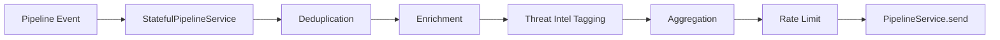

# Stateful Pipeline Transforms

Stateful transforms extend `PipelineService` with middleware that can enrich, aggregate, deduplicate, and filter events before pipeline emission.

## Contracts

- `IPipelineTransform<TIn, TOut>`
- `TransformContext` (`kv`, `logger`, `now`)
- `PipelineTransformChain` fluent composition

## Built-in Transforms

- `DeduplicationTransform`
- `EnrichmentTransform`
- `ThreatIntelTaggingTransform`
- `AggregationTransform`
- `RateLimitTransform`

## Fail-safe Behavior

- Transform failures are logged.
- Default behavior is fail-open (event passes through unchanged).
- `failOpen: false` enables fail-closed dropping on transform errors.

## Custom Transform Authoring

1. Implement `IPipelineTransform`.
2. Register via `.use(...)` on `StatefulPipelineService`.
3. Keep transform side effects idempotent.
4. Write focused tests for drop/pass-through behavior.
