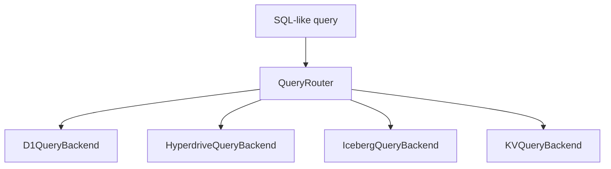

# Federated Query Layer

The federated query layer introduces a single SQL-like interface across D1, Hyperdrive/Postgres, Iceberg/R2, and KV-backed datasets.



## Routing Rules

- Prefix-based:

  - `d1.table_name` → D1
  - `pg.table_name` → Hyperdrive
  - `iceberg.table_name` → Iceberg catalog
  - `kv.*` → KV backend
- Query hint comment override:

  - `-- @backend: d1`

## Security & Validation

- Admin query endpoints must enforce `SELECT`-only allowlists.
- Validate query origins and access tier before execution.
- Clamp row limits.

## Example Queries

```sql
-- @backend: iceberg
SELECT * FROM iceberg.compilation_events WHERE status = 'error';
```

```sql
SELECT key, value FROM kv.cache WHERE key LIKE 'source:%';
```

## Extending Backends

1. Implement `IQueryEngine`.
2. Register backend in `createQueryRouter(...)`.
3. Add routing convention (prefix or hint policy).
4. Update docs with operational constraints.
