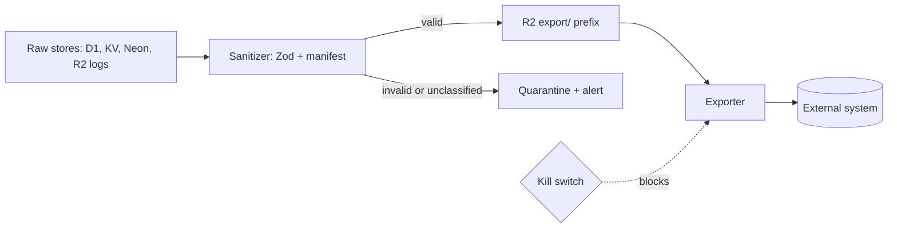

# Edge Data Export Policy

<strong>Status:</strong> Draft for owner and legal review. This is an engineering policy, not legal advice. Retention periods, cohort thresholds and any cross-border transfer basis need sign-off before the first export.

This policy defines what data may leave Bloqr's Cloudflare boundary (Workers, KV, D1, R2, Neon) and flow to any external system: a data lakehouse such as Databricks, a warehouse, an analytics SaaS, a partner, or a data-sharing product. It applies to every current and future exporter. Companion design: [Filter List Intelligence](/analytics/filter-list-intelligence).

Bloqr is a privacy product. The default is that **nothing leaves**, and each field that does must be named, classified and justified.

## Principles

1. <strong>Default deny.</strong> Only fields on an explicit export manifest may leave. A new field is not exported until someone adds it and a reviewer approves the classification.
2. <strong>Minimize, then aggregate.</strong> Prefer public or operational data. If user-linked data is ever needed, export aggregates, never rows.
3. <strong>Purpose limitation.</strong> Each export names the question it answers. Data collected for operations (abuse control, billing, debugging) is not reused for product analytics without review.
4. <strong>No re-identification.</strong> Nothing exported, alone or joined with other exported data, may identify or single out a person, device or private configuration.
5. <strong>Fail closed.</strong> If sanitization, validation or the kill switch fails, the export stops. It never falls back to sending raw data.

## Data classes

| Class | Definition | Examples in this codebase | May leave the edge? |
| --- | --- | --- | --- |
| **0 — Public** | Derived solely from public sources; identical for every user. | Upstream list content, rule hashes, `canonical_text` of public rules, domains in public lists, list metadata, public threat-intel indicators. | Yes, subject to the licence gate (E3). |
| **1 — Operational** | System behavior with no link to a person or private config. | Source-health status and latency, queue depth, rule counts, compile duration buckets, HTTP status codes, error *codes*. | Yes, via the manifest. |
| **2 — Pseudonymous** | Could be linked to a user, device or private config, directly or by joining. | `requestId`, any client IP hash, API key id, user id, session id, `sourceId` of a user-defined source, per-user config names, timestamps at fine granularity combined with the above. | <strong>Never as rows.</strong> Aggregates only, subject to E6. |
| **3 — Personal or secret** | Identifies a person or grants access. | Raw IP, email, auth cookies and tokens, API keys, passwords, user-supplied source URLs (may embed credentials), free-text error messages and stack traces (may contain any of the above), private list content. | <strong>Never.</strong> |

When in doubt, classify upward.

## Classification of the existing analytics tables

| Table | Field | Class | Export decision |
| --- | --- | --- | --- |
| `compilation_events` | `eventId` | 2 | Exclude. |
|  | `requestId` | 2 | Exclude. |
|  | `sourceId` | 1 if a registry source, 2 if user-defined | Export only registry sources (E3). |
|  | `timestamp` | 1 | Truncate to the hour. |
|  | `eventType`, `status`, `format` | 1 | Export. |
|  | `durationMs` | 1 | Export bucketed (E6). |
|  | `ruleCount` | 1 | Export bucketed. |
|  | `errorMessage` | 3 | <strong>Exclude.</strong> Replace with an `error_code` enum (E4). |
| `source_health` | `sourceUrl` | 1 if canonical registry URL, 3 otherwise | Export only the canonical registry URL (E5). |
|  | `healthStatus`, `latencyMs`, `statusCode` | 1 | Export. |
|  | `errorMessage` | 3 | Exclude; use `error_code`. |
| `filter_rule_changes` | `ruleHash`, `changeType`, `sourceId` | 0 (registry source) | Export, subject to E3. |
|  | `beforeRule`, `afterRule` | 0 for public sources, 3 for private | Export only for `public` and `redistributable` sources. |
| `threat_intel_hits` | `indicatorValue` | 0 | Export if from a redistributable feed. |
|  | `matchedRuleId`, `confidenceScore` | 0 | Export. |

## Rules

<strong>E1 — Manifest allowlist.</strong> Each exported dataset has a checked-in export manifest listing every field, its class, and its transformation. The sanitizer drops any field not in the manifest. Schema changes to the source table do not change the export.

<strong>E2 — Class 3 never, Class 2 only aggregated.</strong> No Class 3 field is exported under any circumstance. Class 2 fields are exported only as aggregates that satisfy E6.

<strong>E3 — Public registry sources only.</strong> Only sources marked `public: true` in the source registry are exported. Anything user-defined, private, or fetched with credentials is excluded. List content, including rule text, leaves Bloqr only when the source is also `redistributable: true`; licences differ across popular lists (some share-alike, some non-commercial), and internal analysis rights are not redistribution rights.

<strong>E4 — No free text.</strong> Free-text fields (error messages, stack traces, user input) are never exported. Map them to a closed enum (`TIMEOUT`, `HTTP_5XX`, `PARSE_FAIL`, …) at the sanitizer.

<strong>E5 — URL canonicalization.</strong> Exported URLs have userinfo, query string and fragment removed and the host checked against the registry. A URL that cannot be matched to a registry entry is dropped, not truncated.

<strong>E6 — Aggregation thresholds.</strong>

- Release a cell (a group-by combination) only if it contains at least **k = 20** distinct underlying subjects. Suppress or merge smaller cells. <em>k is a proposal; the owner sets it.</em>
- Use time buckets of at least one hour for Class 1 and one day for anything derived from Class 2.
- Bucket continuous values (duration, rule count) rather than exporting exact values when the exact value adds no analytical benefit.
- Check differencing: releasing overlapping aggregates must not allow a small cell to be recovered by subtraction. If in doubt, coarsen.

<strong>E7 — Pseudonymization.</strong> If a Class 2 identifier must be used inside the sanitizer to compute an aggregate (for example, counting distinct clients), use `HMAC-SHA-256(secret, identifier || bucket)`, truncated to 128 bits, with the secret held in Worker Secrets and **rotated at least daily** so tokens cannot be linked across days. The pseudonym itself is never exported; only the resulting count is.

> <strong>Known gap.</strong> `AnalyticsService.hashIp` (`src/services/AnalyticsService.ts:589-598`) is a 32-bit, unsalted, non-cryptographic hash. It collides heavily and the IPv4 space is small enough to enumerate, so it is not an anonymization control, and `docs/cloudflare/CLOUDFLARE_ANALYTICS.mdx` overstates what it provides ("Client IPs are hashed before storage", "No PII"). Do not use it for anything that leaves the edge. Replace it with the E7 construction, or stop storing client-IP-derived values, before any exporter that touches Class 2 data is enabled. Correct the documentation either way.

<strong>E8 — Dedicated identity and least privilege.</strong> Exporters run as their own Worker or Workflow with a credential scoped to read the `export/` prefix only, and a write-scoped, short-lived credential for the destination (for example an OAuth service principal, not a personal token). Exporters hold no database credentials and cannot read raw Class 2/3 stores. Secrets live in Worker Secrets, never in `wrangler.toml [vars]`, consistent with the repository's Zero Trust rules.

<strong>E9 — Two-stage pipeline with a quarantine.</strong>

The sanitizer validates every record against the manifest schema (Zod, as elsewhere in this codebase). Records that fail go to quarantine and raise an alert; they are never forwarded. Exporters can read only `export/`.

<strong>E10 — Retention and deletion.</strong>

- Class 0 and 1 exports: retain up to 13 months unless the destination's cost or policy requires less. <em>Proposal.</em>
- Aggregates derived from Class 2: retain no longer than 90 days at their finest grain, then roll up. <em>Proposal.</em>
- The destination must support deleting a dataset by export run, so a faulty run can be withdrawn.
- Because no user-level rows are exported, individual deletion requests do not need to propagate downstream. Verify this holds for each new exporter.

<strong>E11 — Residency and transfer.</strong> Record the region of every destination. If any users are in jurisdictions with transfer restrictions, document the legal basis (for example, standard contractual clauses) and complete a data protection assessment before enabling the exporter. Requires legal review.

<strong>E12 — Audit trail.</strong> Each export run writes an audit record: manifest hash, row counts in, out and suppressed, destination, and the run's identity. Alert on schema drift (a source table gained a field the manifest does not mention) and on any non-zero quarantine count.

<strong>E13 — Processors and disclosure.</strong> Before the first export to a third party: execute a data processing agreement, add the vendor to the subprocessor list, and update the public privacy policy and any privacy-related marketing claims so they match what actually happens.

<strong>E14 — Kill switch.</strong> Every exporter is behind a feature flag (the Worker already binds `[[flagship]]`) that defaults to **off**, and is surfaced in the admin panel with its description, as required by the repository's admin governance rules.

## Enforcement

Policy without checks decays. Proposed controls, in order of cost:

1. <strong>Manifest drift test.</strong> A Deno test that fails if a source table's schema gains a field absent from its export manifest. This mirrors the existing `check:drift:admin` pattern.
2. <strong>Sanitizer unit tests.</strong> Golden cases per dataset: every Class 2/3 field is stripped, free text is mapped to enums, URLs are canonicalized, cells below k are suppressed.
3. <strong>Differencing test.</strong> Property-style test that overlapping aggregate releases cannot recover a suppressed cell.
4. <strong>PR checklist.</strong> Any change touching an exporter or manifest requires an explicit classification note.
5. <strong>Periodic review.</strong> Quarterly sample of exported objects against the manifest.

## What this policy does not cover

- Data processed entirely inside Cloudflare (for example, Analytics Engine queried from the dashboard).
- Customer-facing exports requested by that customer about their own data.
- Cloudflare's own handling of traffic and logs, which is governed by the Cloudflare agreement.

## Open decisions for the owner

| Decision | Proposal | Why it matters |
| --- | --- | --- |
| Value of k | 20 | Higher is safer but suppresses more cells on a small user base. |
| Retention periods | 13 months / 90 days | Drives destination cost and risk surface. |
| Whether any Class 2 aggregates are exported at all | No, until the Class 0/1 pipeline proves its value | Removes the main privacy risk while the product question is open. |
| Replace or retire `hashIp` | Replace with the E7 construction | Needed before any user-level aggregate exists, and to fix current documentation. |
| Legal review of transfer basis | Before first third-party export | Depends on user geography. |
